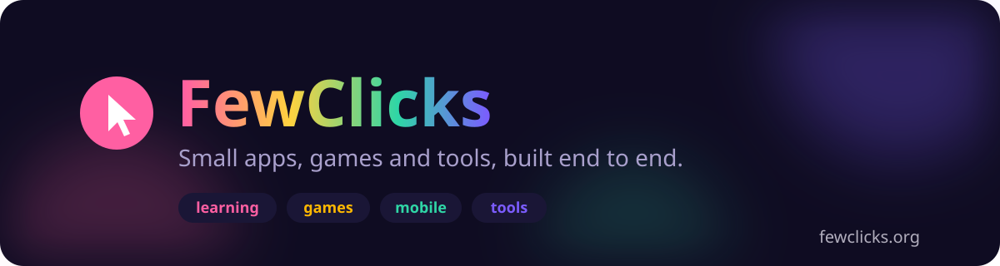

<picture>
  <source media="(prefers-color-scheme: dark)" srcset="assets/banner-dark.svg">
  <source media="(prefers-color-scheme: light)" srcset="assets/banner-light.svg">
  
</picture>

  

## 🧩 What we make

<table>
  <tr>
    <td width="50%" valign="top">
      <h3>📚 Learning</h3>
      <b>Lenix</b> · learn C++ by writing it, from your first <code>main()</code> to a 3D game engine 
      <b>C++ Pathway</b> · a project-based C++ course, beginner to expert 
      <b>PyAIX</b> · learn AI through 30 real-world projects 
      <b>Mathix</b> · maths, step by step 
      <b>Finix</b> · personal finance, from money basics to advanced investing 
      <b>Psychic</b> · how minds, people and money work
    </td>
    <td width="50%" valign="top">
      <h3>🎮 Games and mobile</h3>
      <b>Numix</b> · fast mental-maths games with a difficulty ladder 
      <b>Neuron</b> · offline brain training, 16 exercises 
      <b>Terviq</b> · a private music and video player 
      <b>Aegis Vault</b> · an encrypted, offline file vault
    </td>
  </tr>
  <tr>
    <td width="50%" valign="top">
      <h3>✏️ Creative</h3>
      <b>Glyix</b> · a pixel whiteboard with handwriting recognition 
      <b>Story Writer</b> · write stories with a pen, with 3D characters
    </td>
    <td width="50%" valign="top">
      <h3>🛠️ Tools</h3>
      <b>Resume Builder</b> · edit your resume in the browser, export a PDF, prepare for interviews 
      <b>Crucible</b> · a self-hosted web IDE for C++, Rust, Go, Node.js and Python 
      <b>Matrix</b> · a web desktop for apps running on a server 
      <b>Movix</b> · restore old videos and photos with AI 
      <b>devcert</b> · one local HTTPS certificate for every app
    </td>
  </tr>
</table>

## 👋 Made by Sheshan Lawrence

Full-stack developer. I design the database, build the API and the front end, and ship it: web apps, mobile apps, AI assistants and the infrastructure under them.

  
  
  
  
  
   
  
  
  
  
  
  
   
  
  
  
  
  
  

- 🔐 **Security-minded:** single sign-on, MFA, encrypted data, audit trails, VPNs and network scanning
- 🤖 **AI assistants:** retrieval-augmented chat on WhatsApp, voice notes, document Q&A
- 💸 **Business software:** invoicing, payroll, tax and HR, with the rules they need
- 🚀 **End to end:** from the schema and the API to the UI, the server and the deploy

Most projects are private while they're in progress · say hi at <a href="https://fewclicks.org">fewclicks.org</a>

